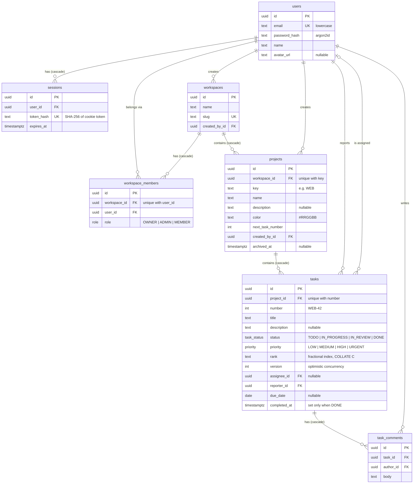

# Database

PostgreSQL 16, managed with Prisma 7. The schema lives in [`apps/api/prisma/schema.prisma`](../apps/api/prisma/schema.prisma) and the migrations in [`apps/api/prisma/migrations`](../apps/api/prisma/migrations).

## Entity relationships



Every table also has `created_at`, and every table except `sessions` and `workspace_members` has `updated_at`. Ids are UUIDv7, so they sort by creation time and keep B-tree inserts local.

## Design notes

- **Deletes.** Deletes cascade only down the containment tree: workspace → members and projects → tasks → comments. Every foreign key that points at `users` is `RESTRICT`, so deleting a user who still owns, reports, is assigned to or commented on anything fails instead of wiping workspace data. The exception is `sessions`, which are credentials and go with their user.
- **Task ordering.** `tasks.rank` holds a [fractional-indexing](https://github.com/rocicorp/fractional-indexing) key. Moving a card writes one row: the API generates a key between its new neighbours. The column uses `COLLATE "C"` so Postgres compares keys byte by byte, the same way the library does. With a locale collation, `ORDER BY rank` would disagree with the generated keys. The board query is served by the `(project_id, status, rank)` index.
- **Task numbers.** `projects.next_task_number` is incremented in the same transaction that inserts the task, and `(project_id, number)` is unique, which gives human-friendly ids like `WEB-42`.
- **Optimistic concurrency.** `tasks.version` starts at 1 and is bumped on every write. Updates send the version they read and get `409 CONFLICT` if it changed.
- **Enums.** `task_status`, `priority` and `role` mirror `TASK_STATUSES`, `PRIORITIES` and `ROLES` in `packages/contracts`. A unit test fails if they drift apart.

### Constraints Prisma can't express

The schema language has no syntax for column collations or `CHECK` constraints, so the second migration adds them in SQL:

| Constraint                                  | Rule                                                   |
| ------------------------------------------- | ------------------------------------------------------ |
| `users_email_lowercase_check`               | `email = lower(email)`                                 |
| `workspaces_slug_format_check`              | kebab-case: `^[a-z0-9]+(-[a-z0-9]+)*$`                 |
| `projects_key_format_check`                 | 2–10 chars, uppercase: `^[A-Z][A-Z0-9]{1,9}$`          |
| `projects_color_format_check`               | `#RRGGBB`                                              |
| `projects_next_task_number_check`           | `>= 1`                                                 |
| `tasks_number_check`, `tasks_version_check` | `>= 1`                                                 |
| `tasks_rank_not_empty_check`                | `rank <> ''`                                           |
| `tasks_completed_at_matches_status_check`   | `completed_at` is set if and only if `status = 'DONE'` |

Prisma's drift detection ignores both, so `prisma migrate dev` won't try to drop them.

## Indexes

| Table               | Index                                                                                                   | Serves                                           |
| ------------------- | ------------------------------------------------------------------------------------------------------- | ------------------------------------------------ |
| `users`             | `email` (unique)                                                                                        | login                                            |
| `sessions`          | `token_hash` (unique), `user_id`, `expires_at`                                                          | session lookup, logout-everywhere, expiry sweeps |
| `workspaces`        | `slug` (unique), `created_by_id`                                                                        | `/w/[slug]` routes                               |
| `workspace_members` | `(workspace_id, user_id)` (unique), `user_id`                                                           | membership checks, "my workspaces"               |
| `projects`          | `(workspace_id, key)` (unique), `created_by_id`                                                         | project list, key lookup                         |
| `tasks`             | `(project_id, number)` (unique), `(project_id, status, rank)`, `assignee_id`, `reporter_id`, `due_date` | board, filters                                   |
| `task_comments`     | `(task_id, created_at)`, `author_id`                                                                    | comment thread in order                          |

Indexes on `created_by_id`, `reporter_id` and `author_id` exist mainly so the `RESTRICT` check on a user delete doesn't scan whole tables.

## Workflow

```bash
pnpm db:up                       # start Postgres (dev DB + test DB)
pnpm db:migrate                  # apply migrations to the dev DB (prisma migrate dev)
pnpm db:migrate --name add_x     # after editing schema.prisma: create and apply a new migration
pnpm db:seed                     # load demo data (safe to re-run)
pnpm db:reset                    # drop everything, re-apply migrations, then seed
pnpm db:studio                   # browse data in Prisma Studio
```

API tests run `prisma migrate deploy` against the test database (`TEST_DATABASE_URL`, default `taskflow_test`) before any test file starts, so there's no manual step locally or in CI.

## Demo data

`pnpm db:seed` creates the **Acme Studio** workspace (`/w/acme`) with a **Website Relaunch** project (`WEB`) and 15 tasks spread over all four columns, some overdue, some unassigned, a few with comments. All users share the password `taskflow-demo` (override with `SEED_DEMO_PASSWORD`).

| User        | Email                 | Role   |
| ----------- | --------------------- | ------ |
| Alex Morgan | `alex@taskflow.dev`   | OWNER  |
| Priya Shah  | `priya@taskflow.dev`  | ADMIN  |
| Sam Lee     | `sam@taskflow.dev`    | MEMBER |
| Jordan Kim  | `jordan@taskflow.dev` | MEMBER |
